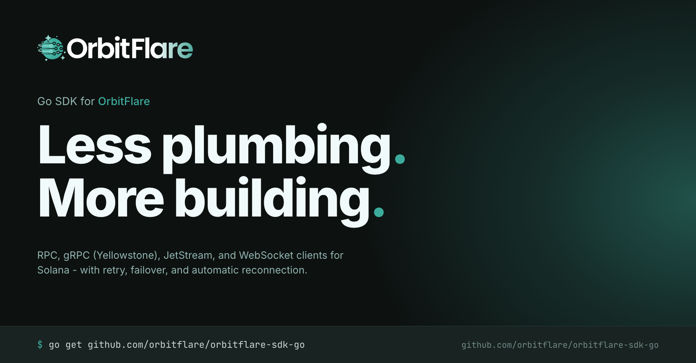

<p align="center">
  
</p>

<p align="center">
  <a href="https://pkg.go.dev/github.com/orbitflare/orbitflare-sdk-go"></a>
  <a href="https://docs.orbitflare.com/sdk/overview"></a>
</p>

# orbitflare-sdk-go

Go SDK for [OrbitFlare](https://orbitflare.com) - RPC, gRPC (Yellowstone Geyser), Jetstream, and WebSocket clients for Solana.

## Install

```bash
go get github.com/orbitflare/orbitflare-sdk-go
```

Requires Go 1.25 or later. Import only the clients you use; each lives in its own package.

```go
import (
    "github.com/orbitflare/orbitflare-sdk-go/rpc"
    "github.com/orbitflare/orbitflare-sdk-go/ws"
    "github.com/orbitflare/orbitflare-sdk-go/geyser"
    "github.com/orbitflare/orbitflare-sdk-go/jetstream"
    jetstreamv2 "github.com/orbitflare/orbitflare-sdk-go/jetstream/v2"
)
```

## RPC

```go
package main

import (
    "context"
    "fmt"

    "github.com/orbitflare/orbitflare-sdk-go/rpc"
)

func main() {
    client, err := rpc.NewBuilder().
        URL("http://ny.rpc.orbitflare.com").
        APIKey("ORBIT-...").
        Commitment("confirmed").
        Build()
    if err != nil {
        panic(err)
    }

    ctx := context.Background()

    slot, _ := client.GetSlot(ctx)
    balance, _ := client.GetBalance(ctx, "CKs1E69a2e9TmH4mKKLrXFF8kD3ZnwKjoEuXa6sz9WqX")
    blockhash, lastValid, _ := client.GetLatestBlockhash(ctx)

    health, _ := client.Request(ctx, "getHealth", []any{})
    raw, _ := client.RequestRaw(ctx, `{"jsonrpc":"2.0","id":1,"method":"getHealth","params":[]}`)

    fmt.Println(slot, balance, blockhash, lastValid, string(health), string(raw))
}
```

### Typed helpers

| Method | Returns |
|---|---|
| `GetSlot(ctx)` | Current slot (`uint64`) |
| `GetBalance(ctx, address)` | Lamports (`uint64`) |
| `GetAccountInfo(ctx, address)` | Account data (`json.RawMessage`) |
| `GetMultipleAccounts(ctx, addresses)` | Slice of accounts (auto-chunks to 100) |
| `GetLatestBlockhash(ctx)` | `(blockhash, lastValidBlockHeight)` |
| `GetTransaction(ctx, signature)` | Full transaction with metadata |
| `GetSignaturesForAddress(ctx, address, limit)` | Recent signatures |
| `GetProgramAccounts(ctx, programID)` | All accounts owned by a program |
| `GetRecentPrioritizationFees(ctx, addresses)` | Recent priority fees |
| `SendTransaction(ctx, txBase64)` | Signature string |
| `SimulateTransaction(ctx, txBase64)` | Simulation result |
| `GetTokenAccountsByOwner(ctx, owner, mint, programID)` | Token accounts |
| `GetTransactionsForAddress(ctx, address, options)` | Full transaction history with filters and pagination (OrbitFlare-specific) |
| `Request(ctx, method, params)` | Any RPC method by name |
| `RequestRaw(ctx, body)` | Raw JSON-RPC body string |

## DAS API

The Digital Asset Standard methods read NFTs, compressed NFTs, MPL Core assets and SPL tokens. They are on the RPC `Client` and use the same endpoint.

```go
asset, err := client.GetAsset(ctx, "GJfYbfW7gufzFYfm8gFatrUE71wYsjay6FwzDkTa3vaD", nil)
fmt.Println(asset.Name(), asset.Owner())

portfolio, err := client.GetAssetsByOwner(ctx, &rpc.GetAssetsByOwnerRequest{
    OwnerAddress: "86xCnPeV69n6t3DnyGvkKobf9FdN2H9oiVDdaMpo2MMY",
    Options:      &rpc.DisplayOptions{ShowFungible: true, ShowNativeBalance: true},
})

tokens, err := client.SearchAssets(ctx, &rpc.SearchAssetsRequest{
    OwnerAddress: "86xCnPeV69n6t3DnyGvkKobf9FdN2H9oiVDdaMpo2MMY",
    TokenType:    rpc.TokenTypeFungible,
    Burnt:        rpc.Ptr(false),
})

// Every asset in a collection, page by page.
all, err := client.AssetPages(rpc.AssetsInCollection("CDDyz6MHYY8972DPCXiEeReCxGqJSCbxHnimrvoyWrFF")).All(ctx)
```

| Method | Returns |
|---|---|
| `GetAsset(ctx, id, options)` | `*Asset` |
| `GetAssetBatch(ctx, ids, options)` | `[]*Asset` in request order, `nil` where not found (auto-chunks to 1,000) |
| `GetAssetProof(ctx, id)` | `*AssetProof` for a compressed asset |
| `GetAssetProofBatch(ctx, ids)` | Proofs keyed by asset ID (auto-chunks to 1,000) |
| `GetAssetWithProof(ctx, id, options)` | Asset and proof in one call, for Bubblegum instructions |
| `GetAssetsByOwner(ctx, req)` | `*AssetList`, with `NativeBalance` when asked |
| `GetAssetsByGroup(ctx, req)` | `*AssetList` |
| `GetAssetsByCreator(ctx, req)` | `*AssetList` |
| `GetAssetsByAuthority(ctx, req)` | `*AssetList` |
| `SearchAssets(ctx, req)` | `*AssetList` |
| `GetTokenAccounts(ctx, req)` | `*TokenAccountList`, by owner, mint or both |
| `GetNftEditions(ctx, req)` | `*NftEditions` of a master edition |
| `GetSignaturesForAsset(ctx, req)` | `*AssetSignatures` (signature and instruction pairs) |
| `AssetPages`, `TokenAccountPages`, `NftEditionPages`, `SignaturePages` | A `Pager` that walks every page: `Next(ctx)` or `All(ctx)` |

`options` may be `nil`. Requests embed `Paging` (`Page`, `Limit`, `Cursor`, `Before`, `After`) and take `SortBy`; use one paging style per request. Pagers copy the request, so it isn't changed. `Asset` has `Name()`, `Symbol()`, `Image()`, `Owner()`, `Collection()` and `IsCompressed()`, and `AssetProof.ProofPath(canopyDepth)` trims the proof for trees with a canopy.

## gRPC (Yellowstone Geyser)

Build the subscription with the typed filter builder:

```go
package main

import (
    "context"
    "errors"
    "fmt"
    "io"

    "github.com/orbitflare/orbitflare-sdk-go/geyser"
)

func main() {
    client, err := geyser.NewBuilder().
        URL("http://ny.rpc.orbitflare.com:10000").
        Build()
    if err != nil {
        panic(err)
    }
    defer client.Close()

    request := geyser.NewSubscribeRequestBuilder().
        Transactions("pumpfun", geyser.NewTransactionFilter().
            Vote(false).
            Failed(false).
            AccountInclude("6EF8rrecthR5Dkzon8Nwu78hRvfCKubJ14M5uBEwF6P").
            AccountRequired("So11111111111111111111111111111111111111112")).
        Accounts("wsol-token-accounts", geyser.NewAccountFilter().
            Owner("TokenkegQfeZyiNwAJbNbGKPFXCWuBvf9Ss623VQ5DA").
            Datasize(165).
            Memcmp(geyser.MemcmpBase58(0, "So11111111111111111111111111111111111111112")).
            Lamports(geyser.LamportsGt(0))).
        Slots("slots", geyser.NewSlotFilter().FilterByCommitment(true)).
        Commitment(geyser.Confirmed).
        Build()

    stream := client.Subscribe(request)
    defer stream.Close()

    ctx := context.Background()
    for {
        update, err := stream.Next(ctx)
        if errors.Is(err, io.EOF) {
            return
        }
        if err != nil {
            panic(err)
        }
        if tx := update.GetTransaction(); tx != nil {
            fmt.Printf("slot=%d\n", tx.GetSlot())
        }
    }
}
```

`Subscribe` accepts a `*geyser.SubscribeRequest` (a re-export of the raw proto type), so you can also construct the request by hand instead of using the builder.

Available filters: `TransactionFilter`, `AccountFilter` (with `Memcmp`, `Datasize`, `Lamports`, `TokenAccountState`), `SlotFilter`, `BlockFilter`, `BlockFooterFilter`, and `DeshredTransactionFilter`.

### Block footers

Alpenglow block footers arrive as their own `BlockFooter` update as soon as the validator reports them, without waiting for the block. Join them with other per-block updates on `(Slot, BankId)`. Certificates are opt-in, and their BLS signatures are not verified:

```go
request := geyser.NewSubscribeRequestBuilder().
    BlockFooter("footers", geyser.NewBlockFooterFilter().IncludeCertificates(true)).
    Commitment(geyser.Processed).
    Build()

stream := client.Subscribe(request)
for {
    update, err := stream.Next(ctx)
    if err != nil {
        break
    }
    if footer := update.GetBlockFooter(); footer != nil {
        fmt.Printf("slot=%d bankId=%d finalCert=%v\n", footer.Slot, footer.BankId, footer.BlockFinalCert != nil)
    }
}
```

### Resuming after a reconnect

`Subscribe` sends the same request on every reconnect. `SubscribeWith` builds the request for each connection instead, so a reconnect can resume from where the stream left off and pick up your current filters. The callback gets the endpoint, the attempt number, whether this is a reconnect, and the highest slot the stream has seen:

```go
const jupiter = "JUP6LkbZbjS1jKKwapdHNy74zcZ3tLUZoi5QNyVTaV4"

stream := client.SubscribeWith(func(info geyser.ConnectInfo) *geyser.SubscribeRequest {
    request := geyser.NewSubscribeRequestBuilder().
        Transactions("swaps", geyser.NewTransactionFilter().Vote(false).AccountInclude(jupiter)).
        Commitment(geyser.Confirmed).
        Build()
    if info.LastSlot != nil {
        from := *info.LastSlot - 32
        request.FromSlot = &from
    }
    return request
})
```

Resume a few slots back rather than at `LastSlot + 1`: the last slot may have been cut off part way through, and the replay sends its remaining updates again, so deduplicate by signature.

When a request sets `FromSlot`, the stream first asks the server how far back it can replay. A slot older than that starts at the oldest available one, and a server without replay starts live, instead of failing the subscription. Both are reported as connection events (below).

### Changing filters on a live stream

Yellowstone applies a new request on an open stream in place of the previous one, so filters can change without reconnecting and without missing anything in between. `Update` sends one; `Handle()` gives a handle that can be passed around:

```go
const pump = "6EF8rrecthR5Dkzon8Nwu78hRvfCKubJ14M5uBEwF6P"

handle := stream.Handle()
err := handle.Update(geyser.NewSubscribeRequestBuilder().
    Transactions("swaps", geyser.NewTransactionFilter().Vote(false).AccountInclude(jupiter, pump)).
    Build())
```

`FromSlot` is ignored on an update. A stream opened with `Subscribe` keeps the updated request for later reconnects; one opened with `SubscribeWith` calls its callback, which should reflect the change.

## Jetstream

```go
package main

import (
    "context"
    "errors"
    "fmt"
    "io"

    "github.com/orbitflare/orbitflare-sdk-go/jetstream"
)

func main() {
    client, err := jetstream.NewBuilder().
        URL("http://ny.jetstream.orbitflare.com").
        Build()
    if err != nil {
        panic(err)
    }
    defer client.Close()

    request := jetstream.NewSubscribeRequestBuilder().
        Transactions("raydium", jetstream.NewTransactionFilter().
            AccountInclude("675kPX9MHTjS2zt1qfr1NYHuzeLXfQM9H24wFSUt1Mp8")).
        Build()

    stream := client.Subscribe(request)
    defer stream.Close()

    ctx := context.Background()
    for {
        update, err := stream.Next(ctx)
        if errors.Is(err, io.EOF) {
            return
        }
        if err != nil {
            panic(err)
        }
        if tx := update.GetTransaction(); tx != nil {
            fmt.Printf("slot=%d\n", tx.GetSlot())
        }
    }
}
```

### Jetstream v2

v2 (`jetstream/v2`) runs on the same endpoint and auth as v1 and is fully additive. Filters are managed at runtime over a bidirectional stream (no reconnect to change them), every response carries a monotonic `Sequence` for gap detection, slot lifecycle events are a separate stream, and transactions can opt into enrichment (fee payer, program ids, compute-unit price, loaded address-table addresses, and more).

```go
package main

import (
    "context"
    "errors"
    "fmt"
    "io"

    jetstreamv2 "github.com/orbitflare/orbitflare-sdk-go/jetstream/v2"
)

func main() {
    client, err := jetstreamv2.NewBuilder().
        URL("http://ny.jetstream.orbitflare.com").
        Build()
    if err != nil {
        panic(err)
    }
    defer client.Close()

    ctx := context.Background()

    version, _ := client.GetVersion(ctx)
    fmt.Printf("version=%s\n", version)

    filter := jetstreamv2.NewTransactionFilter().
        AccountInclude("6EF8rrecthR5Dkzon8Nwu78hRvfCKubJ14M5uBEwF6P").
        IncludeEnrichment(true).
        WithID("pumpfun")

    stream := client.SubscribeTransactions(filter)
    defer stream.Close()

    for {
        resp, err := stream.Next(ctx)
        if errors.Is(err, io.EOF) {
            return
        }
        if err != nil {
            panic(err)
        }
        fmt.Printf("seq=%d\n", resp.GetSequence())
    }
}
```

Add or remove filters on a live stream without reconnecting:

```go
handle := stream.Handle()
handle.AddFilters([]*jetstreamv2.TxFilter{
    jetstreamv2.NewTransactionFilter().AccountInclude("...").WithID("raydium"),
})
handle.RemoveFilters([]string{"pumpfun"})
```

Slot lifecycle events are a separate server stream:

```go
slots := client.SubscribeSlots()
defer slots.Close()

for {
    event, err := slots.Next(ctx)
    if errors.Is(err, io.EOF) {
        break
    }
    if err != nil {
        panic(err)
    }
    fmt.Printf("slot=%d status=%s\n", event.GetSlot(), event.GetStatus())
}
```

Opt into Alpenglow block footers on the same stream. They arrive as `SLOT_STATUS_BLOCK_FOOTER` events, at most once per slot, and are not ordered relative to `SLOT_STATUS_COMPLETE`. The certificates' BLS signatures are not verified, so treat a footer as the leader's claim, not proof of finality:

```go
import pb "github.com/orbitflare/orbitflare-sdk-go/proto/jetstreamv2"

slots := client.SubscribeSlotsWithBlockFooters()
for {
    event, err := slots.Next(ctx)
    if err != nil {
        break
    }
    if event.GetStatus() == pb.SlotStatus_SLOT_STATUS_BLOCK_FOOTER {
        fmt.Printf("slot=%d bankHash=%x\n", event.GetBlockFooter().GetSlot(), event.GetBlockFooter().GetBankHash())
    }
}
```

## WebSocket

```go
package main

import (
    "context"
    "fmt"

    "github.com/orbitflare/orbitflare-sdk-go/ws"
)

func main() {
    ctx := context.Background()

    client, err := ws.NewBuilder().
        URL("ws://ny.rpc.orbitflare.com").
        APIKey("ORBIT-...").
        Build(ctx)
    if err != nil {
        panic(err)
    }
    defer client.Close()

    sub, err := client.SlotSubscribe(ctx)
    if err != nil {
        panic(err)
    }
    defer sub.Unsubscribe()

    for {
        event, ok := sub.Next(ctx)
        if !ok {
            break
        }
        fmt.Println(string(event))
    }
}
```

Subscription methods: `AccountSubscribe`, `LogsSubscribe`, `SlotSubscribe`, `SignatureSubscribe`. All auto-resubscribe on reconnect.

## Endpoint failover

All clients support multiple endpoints with automatic failover and health tracking. The first URL is the primary; the rest are fallbacks.

```go
client, err := rpc.NewBuilder().
    URLs(
        "http://ny.rpc.orbitflare.com",
        "http://fra.rpc.orbitflare.com",
        "http://ams.rpc.orbitflare.com",
    ).
    Build()
```

Failing endpoints are quarantined with exponential cooldown (10s, 20s, 40s, max 60s) and automatically retried once the cooldown expires. Healthy endpoints are always preferred.

## Retry

RPC calls retry on transient errors (5xx, 429, connection resets, Solana error codes -32005, -32007, -32014, -32015, -32016) with exponential backoff before failing over to the next endpoint. 429 responses with a `Retry-After` header are respected.

gRPC, Jetstream, and WebSocket connections use active ping/pong to detect dead connections. Configurable via the builder:

```go
client, err := geyser.NewBuilder().
    URL("http://ny.rpc.orbitflare.com:10000").
    PingInterval(15 * time.Second). // send a ping every 15s (default: 10s)
    MaxMissedPongs(5).              // kill the connection after 5 missed pongs (default: 3)
    Build()
```

All three streaming clients reconnect automatically on disconnection. WebSocket also re-subscribes all active subscriptions after reconnecting. A gRPC or Jetstream request the server rejects as invalid, unauthenticated, forbidden or unimplemented ends the stream with that error instead of reconnecting, and only a connection that delivered a message resets the retry count.

Configure retry behavior with a `RetryPolicy`:

```go
import (
    "time"

    "github.com/orbitflare/orbitflare-sdk-go/orbitflare"
)

client, err := rpc.NewBuilder().
    URL("http://ny.rpc.orbitflare.com").
    Retry(orbitflare.RetryPolicy{
        InitialDelay: 200 * time.Millisecond,
        MaxDelay:     15 * time.Second,
        Multiplier:   2.0,
        MaxAttempts:  5,
    }).
    Build()
```

## Streams

Every streaming client returns a value plus an error from `Next(ctx)`. `io.EOF` signals a clean end (including after `Close`); any other non-nil error is fatal for that stream. `Next` also returns `ctx.Err()` if the passed context is cancelled.

```go
for {
    update, err := stream.Next(ctx)
    if errors.Is(err, io.EOF) {
        break // stream closed
    }
    if err != nil {
        // fatal stream error
        break
    }
    // handle update
}
```

### Connection events

Reconnects are invisible in the update stream itself. Every gRPC and Jetstream stream (v1 and v2, transactions and slots) also reports its connection lifecycle, for health checks, metrics, or deciding a gap needs backfilling:

```go
events := stream.Events()
for {
    event, ok := events.Recv(ctx)
    if !ok {
        break // the stream ended
    }
    switch e := event.(type) {
    case orbitflare.Connecting:
        fmt.Printf("connecting to %s (try %d)\n", e.Endpoint, e.Attempt)
    case orbitflare.Connected:
        fmt.Printf("streaming from %s\n", e.Endpoint)
    case orbitflare.Disconnected:
        if e.WillRetry {
            fmt.Printf("%s dropped (%s); retrying in %v\n", e.Endpoint, e.Error, e.RetryIn)
        } else {
            fmt.Printf("%s dropped (%s); giving up\n", e.Endpoint, e.Error)
        }
    case orbitflare.ReplayClamped:
        fmt.Printf("slots %d..%d are no longer replayable\n", e.Requested, e.Available)
    case orbitflare.ReplayUnavailable:
        fmt.Printf("no replay; started live instead of at %d\n", e.Requested)
    case orbitflare.Lagged:
        fmt.Printf("missed %d events\n", e.Missed)
    }
}
```

Events never hold the stream back: a reader that falls behind by more than 256 events gets `Lagged` instead. The first call to `Events()` also returns what happened before it was called. `Recv(ctx)` waits for the next event and `TryRecv()` returns at once.

### Connection settings

gRPC and Jetstream connections send HTTP/2 keepalive pings every 20 seconds (`.Keepalive(d)`) and accept messages up to 64 MiB (grpc-go's own default of 4 MiB rejects some blocks). Change the limit with `.MaxDecodingMessageSize(bytes)` on the builder.

## Errors

Errors are typed. Match them with `errors.As`:

```go
var rpcErr *orbitflare.RPCError
if errors.As(err, &rpcErr) {
    fmt.Println(rpcErr.Code, rpcErr.Message)
}
```

Types: `TransportError`, `RPCError`, `GRPCError`, `RateLimitedError`, `AuthError`, `StreamError`, `ConfigError`, `SerializationError`, plus `ErrTimeout`. `orbitflare.IsRetryable(err)` reports whether an error is transient.

## Logging

Set `ORBITFLARE_LOG` (`trace|debug|info|warn|error|silent`, default `silent`) for connection lifecycle logs, or pass your own `*slog.Logger` to a streaming builder with `.Logger(...)`.

## Environment variables

| Variable | Used by | Purpose |
|---|---|---|
| `ORBITFLARE_LICENSE_KEY` | all | API key: appended to RPC and WebSocket URLs, sent as `x-token` to gRPC and Jetstream |
| `ORBITFLARE_RPC_URL` | RPC | Default endpoint if `URL()` is not called |
| `ORBITFLARE_WS_URL` | WebSocket | Default endpoint if `URL()` is not called |
| `ORBITFLARE_GRPC_URL` | gRPC | Default endpoint if `URL()` is not called |
| `ORBITFLARE_JETSTREAM_URL` | Jetstream | Default endpoint if `URL()` is not called |
| `ORBITFLARE_LOG` | all | Log level for connection lifecycle events |

## Examples

Runnable programs live in [`examples/`](examples): `rpc`, `das`, `ws`, `geyser`, `geyser_block_footers`, `jetstream`, `jetstream_v2`, and `jetstream_v2_slots`.

```bash
ORBITFLARE_LICENSE_KEY=ORBIT-... go run ./examples/rpc
```
